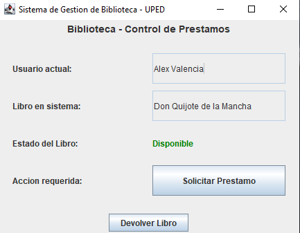
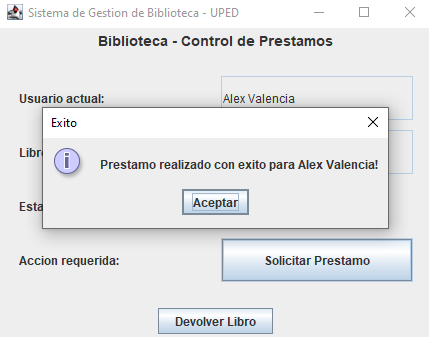
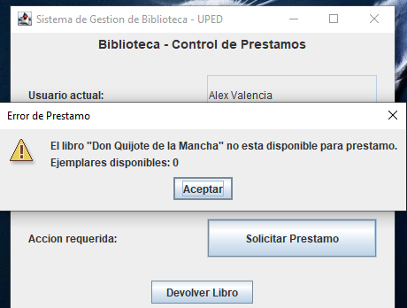
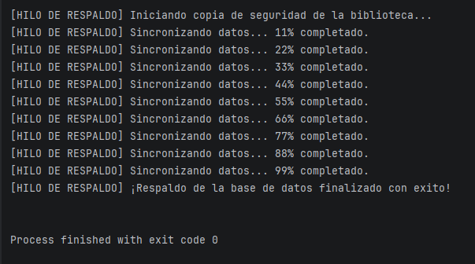

# Sistema de Gestión de Biblioteca

## Integrantes del equipo

---

## Descripción del proyecto

El Sistema de Gestión de Biblioteca es una aplicación desarrollada en Java 
que permite representar y gestionar diferentes elementos relacionados con una biblioteca.
El proyecto permite trabajar con usuarios, 
bibliotecarios, libros, préstamos y categorías, 
aplicando conceptos fundamentales de Programación Orientada a Objetos.
En esta segunda etapa del proyecto se incorporaron conceptos 
de herencia, clases abstractas, polimorfismo, interfaces, 
sobrecarga y sobrescritura de métodos, manteniendo 
la funcionalidad desarrollada en el laboratorio anterior.

---

## Evolución desde el Laboratorio I

En el Laboratorio I se desarrolló la estructura inicial del Sistema 
de Gestion de Biblioteca utilizando clases como:

- Usuario
- Libro
- Préstamo
- Categoria
- Biblioteca

Para este laboratorio se realizó una refactorización del proyecto sin romper la funcionalidad existente y se incorporaron nuevos conceptos de Programación Orientada a Objetos.

Las principales mejoras realizadas fueron:

- Creación de la clase abstracta "Persona"
- Creación de la clase "Bibliotecario"
- Modificación de "Usuario" para heredar de "Persona"
- Implementación de la interfaz "Gestionable"
- Implementación de "Gestionable" en "Usuario" y "Libro"
- Aplicacion de polimorfismo mediante clases relacionadas.
- Implementacion de metodos sobrescritos ("@Override").
- Implementacion de metodos sobrecargados.
- Conservacion de las funcionalidades principales desarrolladas en el Laboratorio I.

---

## Conceptos de Programacion Orientada a Objetos aplicados

### Herencia

Se creo la clase abstracta "Persona", de la cual heredan:

- "Usuario"
- "Bibliotecario"

Esto permite reutilizar atributos y metodos comunes como:

- ID
- Nombre
- Correo
- Teléfono
- "mostrarInformacion()"

---

## Abstraccion

La clase "Persona" fue definida como una clase abstracta.

Ademas, contiene el metodo abstracto:

java: "public abstract void mostrarRol();"

---

## Polimorfismo

Se utiliza polimorfismo mediante referencias de tipo Persona.

Por ejemplo:

Persona persona1 = usuario1;
Persona persona2 = bibliotecario1;

persona1.mostrarRol();
persona2.mostrarRol();

También se utiliza polimorfismo mediante la interfaz Gestionable:

Gestionable objeto1 = usuario1;
Gestionable objeto2 = libro1;

objeto1.mostrarInformacion();
objeto2.mostrarInformacion();

De esta manera, una misma referencia puede trabajar con diferentes 
objetos que implementan el mismo comportamiento.

---

## Interfaces

Se creó la interfaz: "Gestionable"

La interfaz define el método: "void mostrarInformacion();"

La interfaz es implementada por:

Usuario
Libro

Esto permite que ambas clases proporcionen su propia implementación del método 
"mostrarInformacion();"

---

## Sobrecarga de métodos

Se implementaron métodos sobrecargados en la clase Biblioteca.

Por ejemplo: "registrarUsuario(Usuario usuario)"

y: 

"registrarUsuario(Usuario usuario, String fechaRegistro)"

También se implementó la sobrecarga del método buscarLibro(): "buscarLibro(String titulo)"

y:

"buscarLibro(String titulo, String autor)"

La sobrecarga permite utilizar el mismo nombre de método con diferentes parámetros.

---

## Sobrescritura de métodos

Se aplicó sobrescritura mediante el método: "mostrarRol()"

La clase Usuario proporciona su propia implementación:

@Override
public void mostrarRol() {
System.out.println("Rol: Usuario de la biblioteca");
}

Mientras que Bibliotecario proporciona otra implementación:

@Override
public void mostrarRol() {
System.out.println("Rol: Bibliotecario");
}

Esto permite que cada clase tenga un comportamiento específico.

---

## Estructura principal del proyecto

El proyecto está compuesto por las siguientes clases:

- Persona — Clase abstracta base.
- Usuario — Representa a los usuarios de la biblioteca.
- Bibliotecario — Representa al personal bibliotecario.
- Libro — Representa los libros disponibles.
- Prestamo — Representa los préstamos realizados.
- Categoria — Representa las categorías de los libros.
- Biblioteca — Gestiona usuarios y libros.
- Gestionable — Interfaz utilizada para definir el método mostrarInformacion().

---

## Instrucciones para compilar y ejecutar

### Requisitos

Para ejecutar el proyecto se necesita:

- Java JDK 17 o superior.
-  IDEA.
- Git para trabajar con el repositorio.
- Ejecución
- Clonar o descargar el repositorio.
- Abrir el proyecto utilizando IntelliJ IDEA.
- Verificar que el proyecto utilice el JDK correspondiente.
- Ubicar la clase Main.
- Ejecutar el método: "public static void main(String[] args)"
- Verificar la información mostrada en la consola.

---

## Entorno de desarrollo

Lenguaje: Java

JDK: JDK 17

IDE: IntelliJ IDEA

Sistema de control de versiones: Git / GitHub

---

## Clase principal

La ejecución principal del proyecto se realiza desde: Main
Esta clase permite probar las diferentes funcionalidades implementadas en el sistema.

---

## Participación de los integrantes

Integrante y Porcentaje de participación
- Jonatan Alexander Acosta Valencia - 30%
- Dani Emerson Martinez Linares - 25%
- Gersson Mauricio Escobar Dominguez - 25%
- Rene Adalberto Aguilar Gomez - 20%

Total: 100%

---

## Uso de Inteligencia Artificial

Durante el desarrollo del proyecto se utilizo Inteligencia Artificial como herramienta de apoyo para comprender conceptos de programacion, 
como por ejemplo a utilizar README.md, no teniamos ni idea sobre esto,
tambien revisar errores, y reforzar el aprendizaje de Programacion Orientada a Objetos,
sumando tambien los nuevos temas vistos como los hilos, que para aprender sobre ellos, utilizamos
herramientas como la IA.

---

# Laboratorio Numero 3 - Programacion III

Proyecto desarrollado como parte del **Laboratorio N.º 3** .
El sistema implementa un entorno robusto de gestion bibliotecaria 
aplicando programacion orientada a objetos avanzada, 
manejo de excepciones personalizadas, 
gestion de recursos con `try-with-resources`, 
interfaz grafica de usuario en Java Swing y procesamiento concurrente con hilos.

---

## Arquitectura del Proyecto y Paquetes

El proyecto sigue una estructura modular organizada bajo el paquete base `com.uped.proyecto`:

*   **`com.uped.proyecto.modelo`**: Contiene el nucleo del dominio de la biblioteca (`Biblioteca`, `Libro`, `Usuario`, `Bibliotecario`, `Categoria`, `Prestamo`) junto con interfaces como `Gestionable`.
*   **`com.uped.proyecto.excepciones`**: Agrupa las excepciones personalizadas (`PrestamoNoDisponibleException` de tipo *checked* y `UsuarioNoEncontradoException` de tipo *unchecked*) y la clase de registro que implementa `AutoCloseable`.
*   **`com.uped.proyecto.gui`**: Contiene la interfaz grafica de usuario (`VentanaPrincipal`), construida con componentes de Java Swing y expresiones lambda.
*   **`com.uped.proyecto.hilos`**: Implementa la concurrencia mediante la clase `RespaldoBiblioteca` para tareas en segundo plano.

---

## Caracteristicas Tecnicas Implementadas

1. **Excepciones Personalizadas y Reglas de Negocio:**
    * `PrestamoNoDisponibleException` (Checked):Extiende de `Exception`, incluye un atributo extra (`ejemplaresDisponibles`) con su respectivo `getter` y se gestiona mediante la cláusula `throws` y bloques `try-catch`.
    * `UsuarioNoEncontradoException` (Unchecked): Extiende de `RuntimeException` para validaciones de ejecucion.

2. **Gestión de Recursos (`AutoCloseable`):**
    * Implementacion de `RegistroOperaciones` para el control automático de apertura y cierre de flujos de auditoría mediante `try-with-resources`.

3. **Interfaz Grafica de Usuario (Java Swing):**
    * Ventana principal interactiva con gestion de layouts (`BorderLayout`, `GridLayout`), eventos mediante **expresiones lambda** y control de alertas visuales usando `JOptionPane`.

4. **Concurrencia (Hilos / Threads):**
    * Ejecucion de tareas en segundo plano con la clase `RespaldoBiblioteca` extendiendo de `Thread`, permitiendo respaldos concurrentes sin bloquear la interfaz principal.

---

## Instrucciones de Ejecucion

1. Aseguramos de tener instalado **JDK 21** o superior, configurado en nuestro entorno de desarrollo (IntelliJ IDEA).
2. Clona o abre el proyecto en tu IDE.
3. Puedes ejecutar el sistema de dos formas:
    * **Modo Consola (Pruebas del Modelo e Hilos):** Ejecuta el metodo `main` ubicado en la clase principal `Main.java`.
    * **Modo Grafico (GUI Swing):** Ejecuta el metodo `main` ubicado en la clase `com.uped.proyecto.gui.VentanaPrincipal.java`.

---

## Participacion de los integrantes

Integrante y Porcentaje de participación
- Jonatan Alexander Acosta Valencia - 100%
- Dani Emerson Martinez Linares - 100%
- Gersson Mauricio Escobar Dominguez - 100%
- Rene Adalberto Aguilar Gomez - 100%

---

## Evidencias y Capturas de Pantalla

### 1. Interfaz Grafica 
Ventana principal de Swing `JOptionPane`.

### 2. Interfaz Grafica - Prestamo Exitoso
Ventana principal de Swing operando con exito mediante `JOptionPane`.

### 3. Manejo de Excepciones (*Checked*)
Validacion de regla de negocio lanzando `PrestamoNoDisponibleException` con atributo extra de ejemplares.

### 4. Concurrencia (Hilos en Segundo Plano)
Ejecucion concurrente del hilo de respaldo (`RespaldoBiblioteca`) en la consola.

---
*Desarrollado para la asignatura de Programación III - UPED (2026).*
